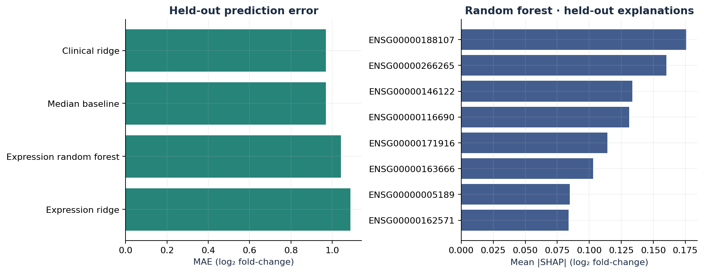

# Influenza vaccine response prediction

**Can baseline whole-blood expression predict the magnitude of the day-28 antibody response?**

Analyze GSE207750 and the companion article's participant table. Compare a median baseline, a clinical ridge model and two expression models for the published average seroconversion endpoint.

## Results

Among **275 participants**, 69 were held out. Clinical ridge MAE was **0.968**, the median baseline **0.969**, expression random forest **1.042** and expression ridge **1.088**, in log₂ fold-change units. Both expression models had negative holdout R². See [all metrics](results/metrics.csv), [feature attributions](results/rf_shap.csv) and the [notebook](analysis.ipynb).



## Methods

Join the GEO TPM matrix to participants using the authors' exact sequencing-run map and cross-check its IDs against GEO. Predict log₂ average seroconversion using only baseline inputs. Fix a 75/25 participant split and use five-fold CV inside the development partition. Fit all feature selection, scaling and imputation inside training folds. The expression models use 30 genes selected in each fit. Compute mean absolute SHAP values for the random forest on the held-out participants.

## Reproduce

Use Python 3.12 in this repository.

```powershell
python -m venv .venv
.\.venv\Scripts\python -m pip install -r requirements.txt
.\.venv\Scripts\python analysis.py
.\.venv\Scripts\python -m unittest discover -v
```

On macOS and Linux, use `.venv/bin/python` in place of the Windows executable.
The analysis downloads public inputs into the ignored `raw/` cache.

The first run fetches about 90 MB of source data. Only aggregate metrics and attributions are included in Git.

## Interpretation

A single cohort, outcome and holdout split limit the claims. Clinical ridge was effectively tied with the median baseline in MAE. This is an independent comparison using a different analysis specification from the original study. SHAP values attribute the fitted model's predictions to features. Gene effects on antibody response would require independent causal evidence.

## Sources and licenses

[NCBI GEO GSE207750](https://www.ncbi.nlm.nih.gov/geo/query/acc.cgi?acc=GSE207750) · [Forst et al. 2022](https://doi.org/10.3390/v14112446) · [Authors' sequencing metadata and analysis](https://github.com/GreshamLab/CIVR_HRP_Day0)

Input URLs and hashes are recorded in [data/sources.json](data/sources.json). The MIT license applies to this repository's code. Original datasets, structures and external scores retain their source terms.
